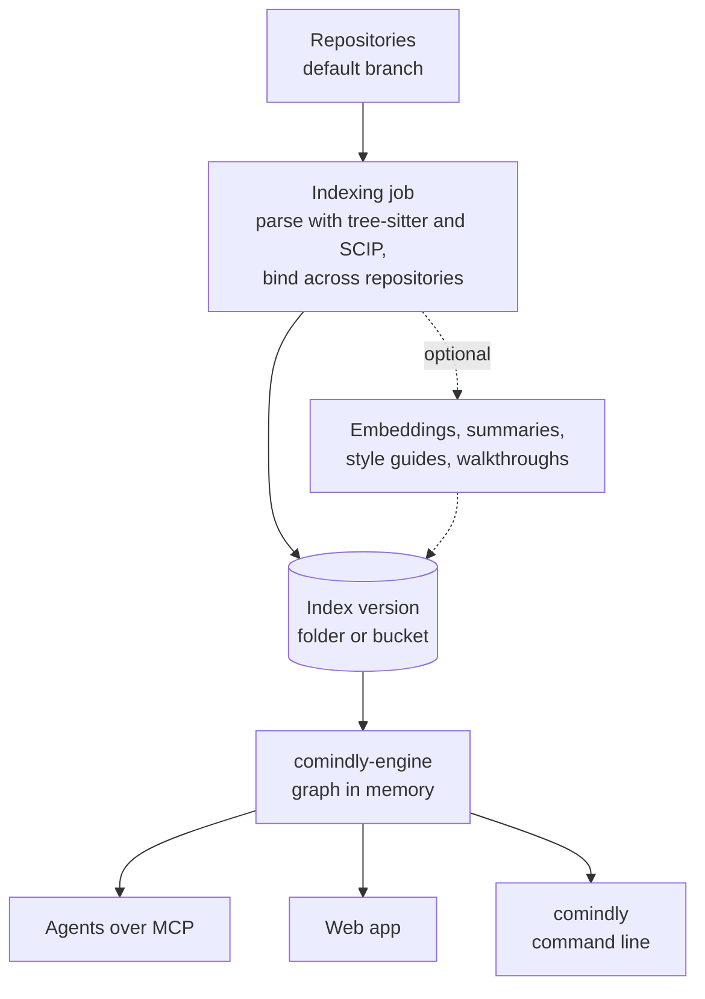
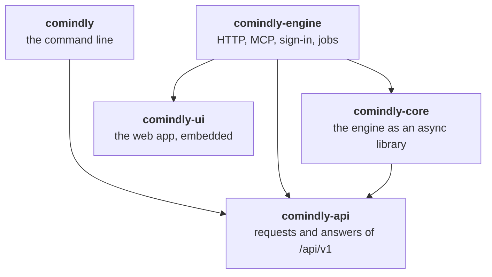
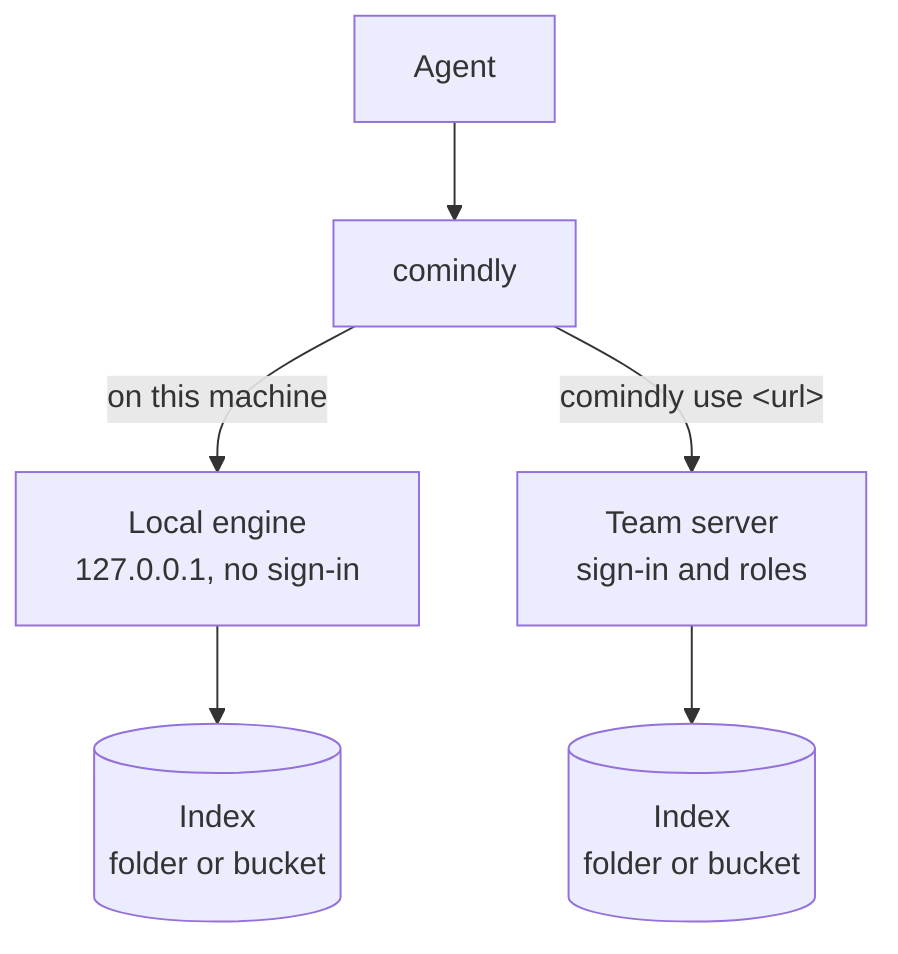

# Architecture

comindly has two programs. `comindly-engine` holds the index and serves it: the web app, `/api/v1`
and MCP for agents. `comindly` is a small command line that talks to an engine, either the one it starts
on this machine or a team's server.

An index is built from the code and written as a new version to a folder or a bucket. It changes when
the code does, and is read far more often than it is written, so comindly keeps it as versioned files
rather than a database that many people write to at once.

## How an index is built and read



- **Building.** An indexing job checks out each repository at its default branch, parses every file,
  and binds references to definitions within and across repositories. A job runs when someone asks
  for it (`comindly link`, the app), when a server's automatic re-index sees new commits, or in CI.
- **Storing.** Each run writes a new version of the Lance tables (`symbols`, `edges`, `file_facts`,
  `search`, `enrichment`, `flows`, `style_guide`, `repo_meta`). Readers always see a complete version;
  earlier ones stay readable. Embeddings and LLM output are reused for code that did not change.
- **Reading.** The engine loads the newest version and builds the symbol graph in memory with
  `petgraph`. A whole organisation's graph fits in memory, so traversals need no graph database.
- **The team's knowledge.** The ledger (`_ledger`), discussions (`_discussions`) and conventions sit
  beside the index in the same location, so whoever can read the index sees them too.

## Symbol identity

Every symbol has a global id in the SCIP scheme:

```text
<scheme> <package manager> <package> <version> <descriptor>
comindly-treesitter . billing-api . billing/invoices/create_invoice().
```

A reference in one repository (`from shared_lib.money import round_cents`) binds to the definition in
another through this id, which gives a cross-repository edge. `ripple` follows those edges backwards to
answer which code in other repositories is affected by a change.

Symbols come from tree-sitter for every supported language, with no compiler or build needed. Where a
repository has a SCIP index (`scip-typescript`, `scip-python`, `rust-analyzer`, `scip-java`), its
compiler-grade answers are used as well. When a name cannot be bound, the edge is left out rather than
guessed.

## Retrieval

Answers come from the graph first; vectors only help when a question is phrased in words rather than
names.

1. **Exact.** Lookups by name or path, and full-text search.
2. **Structural.** Graph traversal: `ripple` (what depends on a symbol), `thread` (what it calls),
   `zoom` (one symbol with its callers, callees and contracts).
3. **Ranked.** `context_pack` ranks symbols by personalized PageRank from the symbols an agent is
   working on, and packs the most relevant code into a token budget.
4. **Semantic.** Embeddings from a local Model2Vec model, combined with full-text search, for questions
   like "where is the code that retries payments". No code leaves the machine for this.

LLM steps (summaries, flow walkthroughs, style guides) are optional and go through any OpenAI-compatible
endpoint.

## Layers

comindly is five crates in one cargo workspace. Each depends only on the ones below it, and the compiler
enforces the boundaries.



- **comindly**: profiles (`comindly use`), the local engine started on demand, and every command as a
  call to an engine's `/api/v1`; MCP over stdio and the agent hooks forwarded to the engine. It never
  opens an index itself.
- **comindly-engine**: axum with `/api/v1`, MCP over HTTP, the web app, sign-in and roles, jobs and the
  backends; this machine's preferences, credentials and checks; the macOS window.
- **comindly-core**: parsing, binding, the index, queries, the ledger and the indexing pipeline.
- **comindly-ui**: the web app (React, in `ui/`), built and embedded in the engine.
- **comindly-api**: the request and answer types, and a typed client (feature `client`).

One `comindly-engine` binary serves both ways: without `COMINDLY_PUBLIC_URL` it is the local engine on
127.0.0.1 (port 7879, or a free port), with a local token and no sign-in; with it, the team server on
0.0.0.0:7878 with sign-in and roles. A local engine writes its address, pid and version to
`engine.json` in the config folder, where the command line finds it.



`comindly-core` reads no environment, no files of its own and no process-wide state, and prints
nothing: everything a call needs is passed in. `comindly-engine` re-exports core, so
`comindly_engine::graph` is `comindly_core::graph`.

### comindly-core

| Area | Modules |
|---|---|
| Model and parsing | `model`, `parse`, `lang/`, `facts`, `packages`, `manifests`, `infra`, `configvals`, `scip` |
| Binding and contracts | `resolve`, `resolve/contracts` |
| Derived knowledge | `conventions`, `recipes`, `checks`, `preflight`, `eval` |
| Index storage | `index` (Lance tables, versions, incremental change detection), `storage` (folder, `s3://`, `gs://`, `az://`) |
| Queries | `graph` (ripple, thread, zoom, flows, ranking), `embed` (Model2Vec + code-aware ranking), `search`, `answers` (what the read commands answer), `view` (what the apps show of an index) |
| LLM steps | `llm` (summaries, flow walkthroughs, style guides), `styleguide` |
| Ledger | `ledger`, `signing` |
| Sources | `worktree` (comindly's own checkouts, git credentials as a trait), `hosting` (listing GitHub organisations and GitLab groups), `git` |
| Indexing | `pipeline`: checkout, link and single-repo indexing as async, cancellable steps |
| Settings | `team` (an index's shared settings), `docstore` (a versioned settings document in LanceDB) |
| Plumbing | `context` (what a call needs), `events` (what it reports), `rt` (the process's one runtime) |

### comindly-engine

| Area | Modules |
|---|---|
| HTTP | `api` (every route's request and answer types, from `comindly-api`), `web` and `web/*` (`/api/v1`, the embedded app, `/health`, `/ready`, graceful shutdown), `mcp` (the tools, over streamable HTTP) |
| Access | `server` (`ServerConfig`, roles, the default account store), `backends` (the traits and SMTP) |
| Work | `jobs` (runner, cancellation, records, live events) |
| This machine | `config` (preferences, identity and signing), `credentials` (API keys), `doctor`, `cache`, `ui` (events as terminal lines or JSON logs), `app` (the macOS window) |

### comindly

`main` (commands), `commands` (each command as API calls), `profile` (profiles and sign-ins),
`engine` (finding, starting, stopping and installing the local engine), `mcp` (stdio forwarded to an
engine's `/mcp`), `hooks`, `doctor`, `render` (answers as terminal text), `git` (what `preflight` and
`changed` read on this machine).

## Contexts, not globals

Core never asks "what is the current team" or reads a settings file. A call receives what it needs:

```rust
pub struct IndexContext {
    pub root: String,                     // where the index lives: a folder or a bucket location
    pub settings: Settings,               // models, LLM steps, limits, prices, SCIP: resolved once
    pub llm: Option<Arc<LlmClient>>,      // absent: LLM steps are skipped and say so
    pub git: Arc<dyn Credentials>,        // tokens for cloning and fetching over HTTPS
    pub report: Reporter,                 // events: steps, results, warnings, progress
    pub cancel: CancellationToken,
    pub cache: PathBuf,                   // comindly's checkouts of each repository
}
```

The engine builds one per job from its settings and stores. Ledger writes take the signer and the writer's identity as
arguments, and reads take the verifier. The web app holds the loaded index (`view::Data`) behind an
`Arc` and swaps it when a new version is indexed.

## Async model

- One Tokio multi-thread runtime per process (`rt::shared`). Core's API is `async`; no function builds
  its own runtime. Synchronous callers block through `rt::block_on`, which hands the worker's other
  tasks over while it waits.
- CPU-bound work (parsing, binding, graph building, embeddings) runs on the blocking pool
  (`spawn_blocking`), so requests stay responsive while a large index builds.
- I/O (object storage, LLM requests, git hosting APIs) is async. LLM requests share one client with a
  concurrency limit from the settings, and stop when the job is cancelled.
- Cloning, fetching and checkouts use the `git` program on the blocking pool: partial clones
  (`--filter=blob:none`) and the machine's credential helpers need it. Cancellation takes effect
  between repositories. `ssh-keygen` is used only for optional record signing.

## Jobs

Indexing runs as an engine job, each run in a child `comindly-engine index-job` process so its memory goes back when it ends.

- **One at a time, in order.** A job has an id, a kind, who started it, a status (queued, running,
  succeeded, failed, cancelled, interrupted) and its events. Starting one while another runs queues it;
  up to 5 wait, and a request identical to a waiting one (same kind and options) returns that job
  instead of adding another. The running job never absorbs a request, since its input may already be
  stale. A queued job reads the repository list and settings when it starts, not when it was asked
  for. The automatic re-index queues the same way.
- **Cancellation.** A `CancellationToken` checked between units of work; cancelling stops LLM requests
  in flight and leaves everything already saved in place. Cancelling a queued job takes it out of the
  queue without starting it.
- **Resumable steps.** Summaries, flow walkthroughs and style guides are saved as they are written and
  reused while their input is unchanged, so a cancelled or interrupted job continues where it stopped.
- **Events.** Each job's events are kept with its record (the last 400; progress replaces earlier
  progress of the same step), streamed live (`/api/v1/jobs/{id}/events`, server-sent events) and
  written to the log. The record is saved when it is queued, when it starts, every 15 seconds and
  when it ends. Following a queued job streams a note with its position until it starts.
- **Restarts.** A job still marked running or queued at start-up is marked interrupted; a queued one
  says it never ran. Queued work is not run after a restart: what it would do is code, not data, and
  rebuilding it from a stale request could index what nobody asked for any more. On SIGTERM the
  waiting jobs are marked the same way.

`comindly link` and `comindly index` start or queue the engine's job, local or a server's, and follow
its events in the terminal.

## Backends

What the server stores and how it signs people in are traits, with comindly's defaults behind them:

| Trait | Default |
|---|---|
| `AccountStore` (members, roles, invitations, sessions, codes, personal access tokens) | signed LanceDB table at the index location (`_server`) |
| `AuditLog` (who changed what, for admins) | the same table |
| `Authenticator` (session cookie or bearer token → who) | the same table, plus the deployment's admin token |
| `DeviceSignIn` (command-line sign-in approved in the browser) | the same table; the issued token sealed until collected |
| `SecretStore` (git and LLM tokens) | the same table, values encrypted with `COMINDLY_SECRET_KEY` |
| `SettingsStore` (the repositories the server indexes) | the same table |
| `JobStore` (job records and their events) | the same table; the local app keeps them in memory |
| `Mailer` | SMTP (`COMINDLY_SMTP_URL`) |

Rows in the table are signed with a key derived from `COMINDLY_SECRET_KEY`, so rows written by anyone
else are ignored. Other implementations, for example a relational database or single sign-on, plug in
without changes to core or to the HTTP layer.

## Roles

Admin, member and viewer. Viewers read; members also write to the ledger and conventions; admins also
manage people, repositories, settings, secrets and indexing. The HTTP layer checks the role a request
needs, the account store checks who may change whom, and MCP tools that write check the role of the
person whose token the agent uses.

## API

- `/api/v1`: JSON. The web app and the command line use it. The answers the read commands print
  (`/api/v1/answer/*`) are the types in `comindly_core::answers`, computed by the same functions on the
  local engine and on a server, so a command prints the same against either. `answer/hook` gives the
  agent hooks their context and `answer/guide` the style guides.
- Types: every route's request and answer is a type in `comindly-api` (grouped by area,
  reusing domain types such as `answers::*`, `graph::Node` and `jobs::JobRecord`); handlers return them and
  the CLI's client reads them, so the server and the command line cannot disagree on a shape.
- Errors: one shape, `{ "error": { "code", "message" } }`, with HTTP status codes that mean what they say.
- `/mcp`: MCP over streamable HTTP for agents, with a personal access token on a server or the local
  token on the local engine. `comindly serve` forwards stdio to it.
- `/health` (alive) and `/ready` (an index is loaded and the accounts can be read).

## Configuration

| Whose | Where | Read |
|---|---|---|
| The deployment's | `COMINDLY_*` variables, each also as `*_FILE` | once at start into `ServerConfig`, checked |
| A server's own | the `SettingsStore` | when used |
| An index's shared settings | `<index>/_team`, a versioned document | when an index is loaded, and after each save |
| One person's preferences | a versioned document in the config folder | the engine re-reads them every few seconds |

API keys stay in a credentials file, and the command line's profiles and sign-ins in `profiles.toml`,
each readable only by its owner.

## Observability

- Every message is an event: timestamp, level, kind, step, message and fields (counts, tokens, cost).
  `COMINDLY_LOG_FORMAT=json` writes one JSON object per line; otherwise readable lines.
- Logs go through `tracing`; the server renders them in the formats above, and core still only reports
  events to a sink, reading no environment.
- Every HTTP request gets a request id (a safe incoming `X-Request-Id`, else a new one), returned in
  `X-Request-Id` and carried as `request_id` by every log line written while handling it. A job's
  events carry its `job_id` and the `request_id` that started it; the job record keeps it too.
- One access line per request (method, path without query, status, duration, member email). `/health`
  and `/ready`, and every request to the local app, log it at debug.
- With `OTEL_EXPORTER_OTLP_ENDPOINT` set, spans per request and per job go out over OTLP/HTTP. The
  exporter sits behind the `otel` cargo feature (on by default) and is configured at startup.
- Graceful shutdown: on SIGTERM or Ctrl-C, stop accepting requests, let a running job stop at its next
  checkpoint and save its record.
