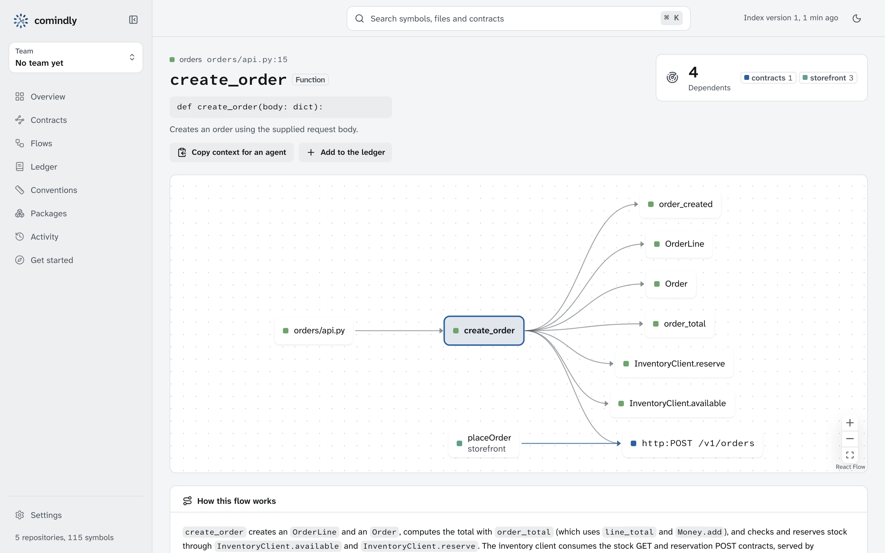

<p align="center">
  <picture>
    <source media="(prefers-color-scheme: dark)" srcset="https://raw.githubusercontent.com/sayef/comindly/main/assets/banner-dark.svg">
    
  </picture>
</p>

<p align="center">
  <b>Your team's engineering memory for coding agents.</b><br>
  Know what breaks before you change it.
</p>

<p align="center">
  <a href="https://comindly.pages.dev/">Docs</a> ·
  <a href="https://comindly.pages.dev/getting-started/">Getting started</a> ·
  <a href="https://comindly.pages.dev/reference/mcp/">MCP tools</a> ·
  <a href="CHANGELOG.md">Changelog</a> ·
  <a href="CONTRIBUTING.md">Contributing</a>
</p>

<p align="center">
  <a href="https://github.com/sayef/comindly/actions/workflows/ci.yml"></a>
  <a href="https://crates.io/crates/comindly"></a>
  <a href="LICENSE"></a>
</p>

<p align="center">
  <picture>
    <source media="(prefers-color-scheme: dark)" srcset="https://raw.githubusercontent.com/sayef/comindly/main/docs/assets/screenshots/explorer-dark.webp">
    
  </picture>
</p>

comindly indexes all of a team's repositories into one graph and gives it to coding agents such as
Claude Code, Cursor and Codex over MCP. Agents can then answer questions that grep and single-repository
search cannot:

- What breaks in other services if I change this function?
- Who calls this route, and who consumes this queue?
- What should I read before changing this, and which conventions apply here?
- Why is this code written this way, and what did the team already try?

The graph comes from the code itself (tree-sitter, and SCIP where available) for Python,
TypeScript/JavaScript, Go, Java, Kotlin and Rust, so answers are exact and repeatable. The team's
decisions, constraints and failed attempts are recorded next to the code they are about. One binary,
written in Rust.

## Install

```sh
curl -LsSf https://raw.githubusercontent.com/sayef/comindly/main/scripts/install.sh | sh
```

Prebuilt for macOS and Linux. Or `cargo install comindly` (Rust 1.95+, `protoc` and `cmake`).

## Try it

```sh
comindly link ../orders ../payments ../shared-lib      # index your repositories
claude mcp add --scope user comindly -- comindly serve  # connect Claude Code
comindly app                                            # or look around in the app
```

Then ask your agent, for example: "What breaks in other services if I change `place_order`?"
The app's **Get started** page has the setup for Cursor, Codex and VS Code, and checks your machine.
LLM summaries and flow walkthroughs are optional and use `OPENAI_API_KEY` or any OpenAI-compatible endpoint.

## For a team

One container serves the index, the app and MCP to a whole team, with sign-in through your identity
provider or by email, roles, and teams. The index lives in a folder or a bucket (S3, Google Cloud
Storage, Azure). See [Self-hosting](https://comindly.pages.dev/guides/self-hosting/).

## Learn more

- [Getting started](https://comindly.pages.dev/getting-started/) and [using it with agents](https://comindly.pages.dev/guides/agents/)
- [Command reference](https://comindly.pages.dev/reference/cli/) and [MCP tools](https://comindly.pages.dev/reference/mcp/)
- [Building the index in CI](https://comindly.pages.dev/guides/ci/)
- [Architecture](ARCHITECTURE.md)

## License

MIT
