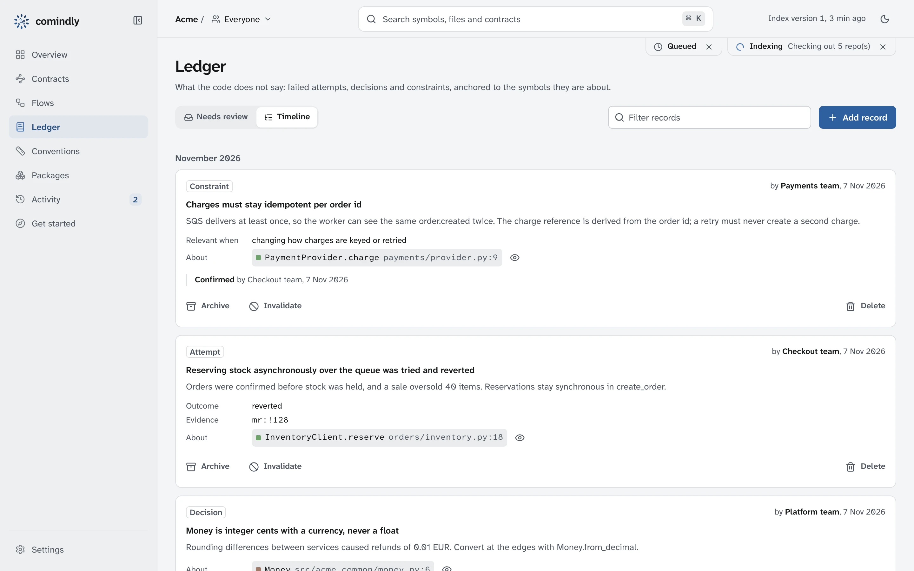

# The app

`comindly app` opens the web app of the profile in use: the local engine's, or a team server's.

## Desktop app (macOS)

On macOS, `comindly app` opens the app in its own window, like the Ollama app: the operating
system's WebKit, no browser and no bundled Chromium. Links to other sites open in your browser. On
Linux and Windows, `comindly app` opens the same app in your browser instead.

With the local engine, the window is signed in with the engine's local token. With a team server's
profile, the window opens that server's app, and the title shows which server. You sign in in the
window as in a browser, and it remembers the session. A sign-in link from an email opens in your
browser; to sign the window in with it, copy the link and choose **View → Open Link from Clipboard**
(<kbd>⌘L</kbd>).

## In the browser

The local engine serves the app on 127.0.0.1 only, and only with its access token, so other programs
and web pages cannot call its API. `comindly app` opens it with the token; the browser keeps the token
in a cookie, so the plain address works as a bookmark afterwards (`comindly engine status` shows it).
The token is kept in `~/.config/comindly/ui-token`; delete the file to issue a new one. A team server
serves the same app to its members ([Self-hosting](self-hosting.md)).

The sidebar collapses to icons with the button beside the logo or `⌘ \`, and stays that way in this
browser; on a phone it opens from the menu button. Filters are part of the address, so a filtered view
can be bookmarked or shared.

- **Overview**: counts with their breakdown (symbols per repository, contracts by type), what needs
  attention (above the map when there is something to review), the org map, a version slider to compare
  with earlier index versions, the flows that reach furthest, symbols per repository and version skew. The org map shows one
  repository at a time: the repositories that use it above, the ones it uses below, and the list of all
  repositories beside it, ordered by how many depend on each; click a box or a name to move there.
  Blue arrows go through a contract, grey ones are imports and calls, dashed amber ones are part of a
  cycle, and hovering or tabbing to an arrow lists the contracts and code references behind it. On a
  phone you pick the repository from a list above the graph. **Tree** switches to a tree from the entry points (or
  any repository) to what each uses, or turned around to what uses it; **cycles** lists every group of
  repositories that depend on each other in a circle.
- **Contracts**: every route, queue, topic, bucket and table with its providers and consumers, filtered
  by type, by whether both sides are indexed, and by name.
- **Ledger**: records that need a look (disputed, stale or orphaned, and likely repeats) and the
  full timeline. **Add record** writes a new one under your name; each record shows
  who wrote it and its review history; confirm, archive, invalidate or delete it. The symbol view
  has **Add to the ledger** with that symbol filled in.
- **Flows**: where work starts and where it travels. Each flow follows calls and then crosses
  contracts: an HTTP route to the handler that serves it in another repository, a topic to the queues
  subscribed to it, a queue to the code that polls it. The list shows the repositories each flow
  passes through in order and the contracts it crosses; a flow opens as a tree of every step, with the
  steps that enter another repository marked. With LLM summaries on when indexing, the furthest-reaching
  flows also get a written walkthrough.
- **Conventions**: every measured and team convention in one table, filtered by scope (org-wide or a
  repository), topic, origin and text, and sorted by scope, topic or how strictly it is followed. Each
  rule reads as an instruction, with a word for how strictly the code follows it (always, usually,
  often or sometimes) and a note where there are few examples. Expand a row to see what it was
  measured from and where it comes from: the places that follow it and those that deviate, each with its code
  as indexed and a link to it on GitHub or GitLab. Recipes, learned from commit history, list commits.
  Add your own, edit or hide measured ones (hidden ones can be restored). `/conventions?repo=<name>`
  opens one repository.
- **Packages**: internal packages, who publishes each, and the version every consumer pins, marked
  when it is behind the publisher (or ahead of the version in its source).
- **Repositories**: what is in the index, and where each repository lives on this machine.
  **From GitHub or GitLab** lists the repositories of an organisation or group (github.com, GitHub
  Enterprise, gitlab.com or a self-hosted GitLab, subgroups included) with your existing git login, a
  `GITHUB_TOKEN` / `GITLAB_TOKEN`, or a token it asks for once (kept by your git credential helper). Tick
  the ones you want: comindly keeps its own copies under `~/.local/share/comindly/repos` (cloned on the
  first **Index now**, without file contents until needed), so you choose no folder. With **Share with the
  team**, the list is stored in the team settings, and a colleague sees "The team has N repositories you
  don't have here" with **Add them**. You can also add a folder, scan a folder, or clone a single
  repository by URL. Every repository is always indexed at its remote's current default branch, whatever
  it is called (main, master, trunk…), asked from the remote on each run. The index records each
  repository's remote URL, so one indexed elsewhere shows **No folder here** with **Locate** and **Add**.
  comindly indexes all repositories together so cross-repo links stay complete, so **Index now** waits
  until every indexed repository has a folder here, unless you choose to drop the missing ones. With
  **Re-index automatically** on (`auto_index`), the app checks every few minutes (`auto_index_minutes`,
  default 5) whether a default branch moved on the remote and re-indexes when one did, with the LLM steps
  for new or changed code only if **With LLM steps** is on (`auto_index_llm`); all three are among the
  index's shared settings.
- **Settings**: the index location (with a connection test), the org name, your name on ledger
  records, and how often to check for a new index version. **Models & prompts** holds the LLM setup
  (endpoint, a model per task, embedding model, LLM steps, limits, prices and the API key) and the
  instructions for summaries, style guides and walkthroughs, with saved versions to try and activate,
  and **Rewrite everything** (see [Configuration](configuration.md#models-and-prompts)). Changing the
  index location switches the UI without a restart. On a team server, Settings also has **Members** and **Integrations**
  (admins) and **Your access** (your sign-in code, personal access tokens and how to connect an agent);
  viewers see everything read-only.
- **Activity**: what comindly works on in the background. Tiles count what runs, waits, succeeded and
  failed (click one to filter); the list groups runs under **Now**, **Today**, **Yesterday** and earlier
  days. A run opens as a timeline: one row per step with its duration, its results, notes, warnings and
  errors, a live progress bar for the step in progress, and the LLM tokens and cost. **Plain log** shows
  the text to copy into an issue; the request id finds the run in the server's logs. Admins can cancel a
  run or remove it from the queue. The server keeps the last 50 runs.
- **Approving a command line**: `comindly use <url> <name>` and `comindly login` open `/device?code=…`; the page shows which machine
  asks to act as you and the code its terminal shows, with **Approve** and **Deny**.
- **Get started**: checks of this setup (as `comindly doctor`), how to register the MCP server with
  Claude Code, Cursor, Codex or VS Code, hooks, and every MCP tool
  with a question that uses it.
- **Symbol view**, opened from search, a link or a graph node: the dependency graph (dependents
  on the left, dependencies on the right), blast radius, the LLM summary and flow walkthrough when
  the index has them, contracts and recorded reasoning. **Copy context for an agent** copies what to
  read before changing it, with the team's records, as markdown.

### What it looks like

The example company in `examples/acme`, indexed with comindly (`scripts/screenshots.sh`).

/// caption
Overview: the org map with the service contracts between repositories
///

/// caption
A symbol: its dependency graph, blast radius, summary and flow walkthrough
///

/// caption
Contracts: routes, topics, queues, buckets and tables with providers and consumers
///

/// caption
Ledger: constraints, failed attempts and decisions, with who wrote and confirmed them
///

/// caption
Packages: an internal package and a consumer pinned behind its publisher
///

/// caption
Flows: where work travels, across repositories
///

/// caption
A flow: every step, entering orders, inventory and payments
///

/// caption
Conventions: one table, with where each comes from
///

/// caption
Search: describe what you are looking for
///

/// caption
Activity: indexing runs grouped by day, one opened as a timeline of its steps
///

/// caption
Get started: register the MCP server with your agent
///

What is running hangs under the header's right corner (indexing with its current step, a queued run
beside it, or any action in progress), with **Cancel** where it can be stopped; indexing stops at its next checkpoint and keeps
what it already saved. Clicking it opens the run under **Activity**, whose sidebar entry counts what
runs and waits. Finished actions appear as toasts in the bottom-right corner.

**View as agent**, on the overview, contracts, flows, conventions, repositories and every symbol,
shows the answer an agent gets from the matching MCP tool for what the page shows, with the page's
team and filters applied. The eye icon on each contract, ledger record and repository does
the same for that one item. Copy it into an agent that is not connected to comindly, or
use it to see what a connected one is told.

Press <kbd>⌘K</kbd> (<kbd>Ctrl K</kbd>) anywhere to search: by name, and by describing what you are
looking for ("where do we retry HTTP calls"), which uses the same hybrid search as the MCP `search`
tool. Graphs scroll with the page; pinch or <kbd>⌘</kbd>/<kbd>Ctrl</kbd> and scroll to zoom, drag to
pan. Dark by default; the header toggles a light theme. Against a read-only index, editing is hidden.
